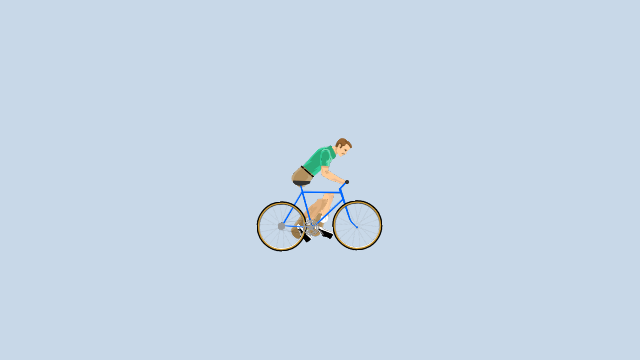

# Happy Wheels in Rust

Port of Happy Wheels (Flash/JS) to Rust: Box2D 2.0.1 port, level loader, characters, vehicles, sound, sprite rendering. Checked against the original game via golden tests.

Site: https://lakomoor.github.io/happywheels-rs/

```
cargo test
cargo run -p happywheels -- --help
```

Original game assets are **not** included; point the app at your own copy of the assets. See [docs/PORT.md](docs/PORT.md) for status.



