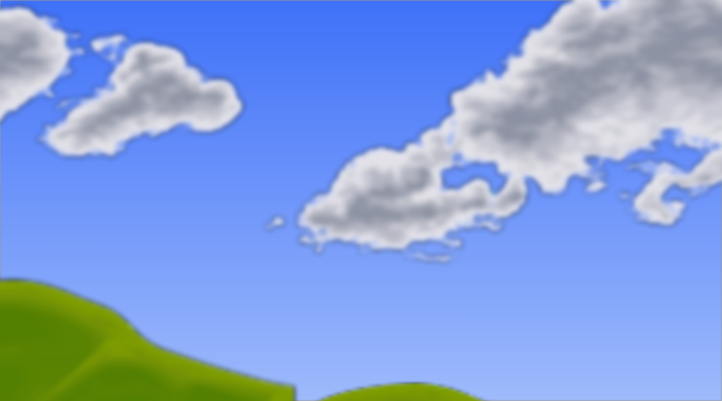

# Happy Wheels in Rust

Port of Happy Wheels (Flash/JS) to Rust: Box2D 2.0.1 port, level loader, characters, vehicles, sound, sprite rendering. Checked against the original game via golden tests.

Site: https://lakomoor.github.io/happywheels-rs/

```
cargo test
cargo run -p happywheels -- --help
```

## Browser preview

The experimental WebGPU preview runs a sample level or a local level XML file.
It uses placeholder geometry until you select a local copy of the original
assets folder. Sound uses the original audio sprite from that folder. The selected files stay in the browser.
Install the `wasm32-unknown-unknown` Rust target and `wasm-bindgen-cli` matching
the version in Cargo.lock (currently 0.2.130), then run:

```sh
cargo install wasm-bindgen-cli --version 0.2.130 --locked
sh web/build.sh
python3 -m http.server --directory web 8000
```

If a different `wasm-bindgen` is already installed, set `WASM_BINDGEN` to the path
of the matching executable when running the build script.

Open `http://localhost:8000` in a browser with WebGPU enabled. Arrow keys,
Space, Z, Shift and Control control the rider; Escape pauses. Select a character before opening
a level XML file, or press Restart level to start the current level with the selected character. After selecting the original assets folder, Open menu displays the port's partial main menu and character selection; browsing levels, editor and options are not implemented.

Original game assets are **not** included; point the app at your own copy of the assets. See [docs/PORT.md](docs/PORT.md) for status.




## Multiplayer

`happywheels --level level.xml --blood 0|1|2` picks the blood look (0 none, 1 bitmap drops (default), 2 lines).

`happywheels --level level.xml --window --players 2` — local split screen (P1: arrows/Space, P2: WASD/F). Online race: `--host 7777` on one machine, `--join HOST:7777` on the other (same level file).

## Assets, distribution and known gaps

- **Assets are not distributed.** The original Happy Wheels artwork, audio and fonts belong to their rights holders. `assets/` is git-ignored, the browser build (`web/pkg/`) is not published, and the code only reads a copy of the assets that you supply (a folder for the desktop app, a folder picked in the page for the browser; picked files stay in the browser).
- **Screenshots caveat.** `screenshots/` and `docs/screenshots/` (and so the GitHub Pages site) contain frames rendered with the original artwork. If you redistribute the repository or want to be strictly asset-free, delete the screenshots rendered with sprites (those named `sprites_*`, `mower_*`, `harpoon_*`, `arrow_*`, `blood_*`, …) or regenerate them with the placeholder renderer.
- **Browser version.** `sh web/build.sh` builds the wgpu/WebGPU front end; it was smoke-tested in desktop Chrome (headless, sample level starts and renders, characters selectable). Needs a browser with WebGPU; without the asset folder it draws the flat placeholder art and has no sound. Verified only in Chrome on macOS.
- **Verification against the original.** Box2D stepping, many specials and characters are compared numerically against the original running in headless Chrome (`analysis/` oracle scripts, golden tests in `crates/happywheels-core/tests/golden.rs`). Visual items and sounds are checked by eye only. Everything that is approximate, unverified or not ported is listed per item in [docs/PORT.md](docs/PORT.md); the main open ones are the metaball blood looks (blood settings 3/4), NPC voices/poses/`removeBody`, the mower's mask clips (`bladeCoverMC`, `targetMaskHolder`), stats/achievements, most of the ~330 non-core sound effects, online play across different machines, and the level browser/editor/options screens.
